<p align="center">
  <a href="https://kerfscript.mylasertools.com">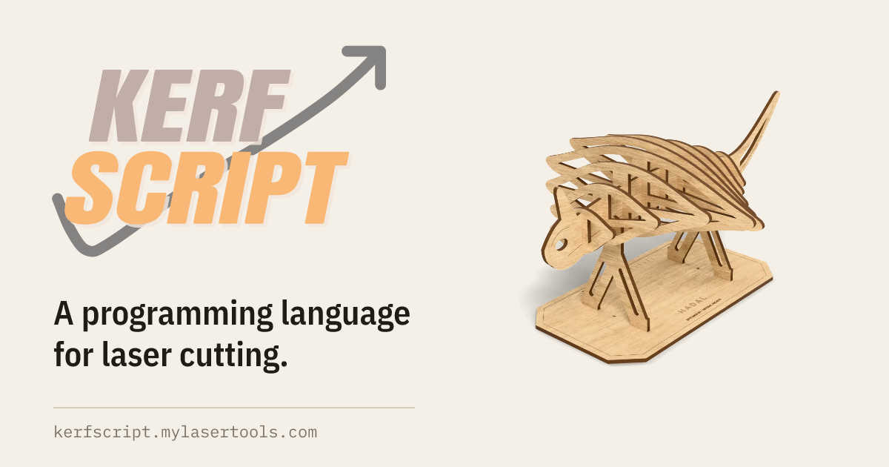</a>
</p>

<p align="center">
  <a href="https://www.npmjs.com/package/@mylasertools/kerfscript"></a>
  <a href="COMMERCIAL-LICENSE.md"></a>
  <a href="LANGUAGE.md"></a>
  <a href="https://kerfscript.mylasertools.com/playground/"></a>
</p>

<p align="center">
  <a href="https://kerfscript.mylasertools.com">Website</a> ·
  <a href="https://kerfscript.mylasertools.com/playground/">Playground</a> ·
  <a href="https://kerfscript.mylasertools.com/models/">Models</a> ·
  <a href="https://kerfscript.mylasertools.com/docs/">Docs</a> ·
  <a href="https://www.npmjs.com/package/@mylasertools/kerfscript">npm</a>
</p>

Write a part once as code, change a number, and get a new cut file. KerfScript
is to laser cutters what OpenSCAD is to 3D printers, except it was designed for
flat parts from the start: cut, score and engrave layers, kerf compensation,
finger joints, living hinges, parts and sheets are part of the language.

<p align="center">
  <a href="https://kerfscript.mylasertools.com/playground/?model=fractal-tree">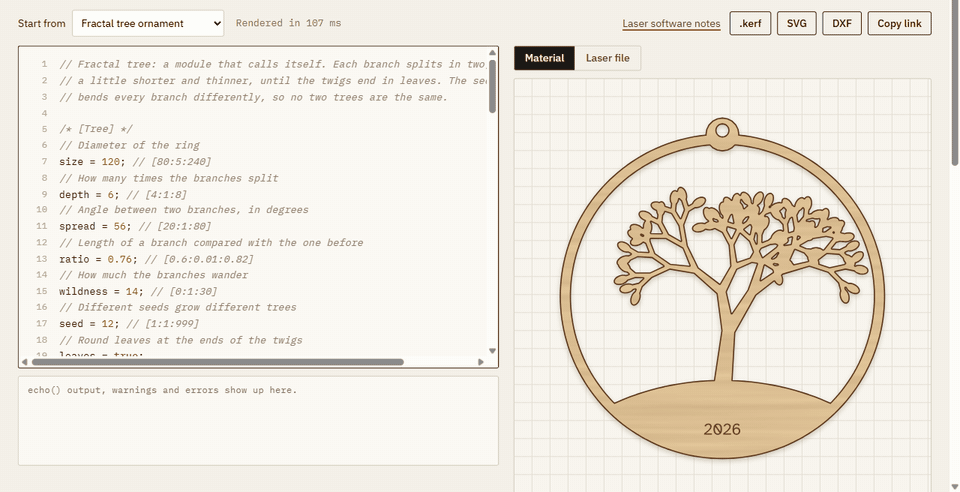</a>
  <br><sub>The <a href="https://kerfscript.mylasertools.com/playground/">playground</a> runs the interpreter in your browser. A comment after a number turns it into a slider.</sub>
</p>

## Example

<table>
<tr>
<td width="50%" valign="top">

```kerf
use <kerf/box>

/* [Size] */
width = 120; // [40:5:400]
depth = 80; // [40:5:400]
height = 50; // [20:5:300]
lid = true;

/* [Material] */
$thickness = 3; // [1.5:0.5:10]
$kerf = 0.15; // [0:0.01:0.5]

box([width, depth, height], lid = lid);
```

</td>
<td width="50%" valign="top">
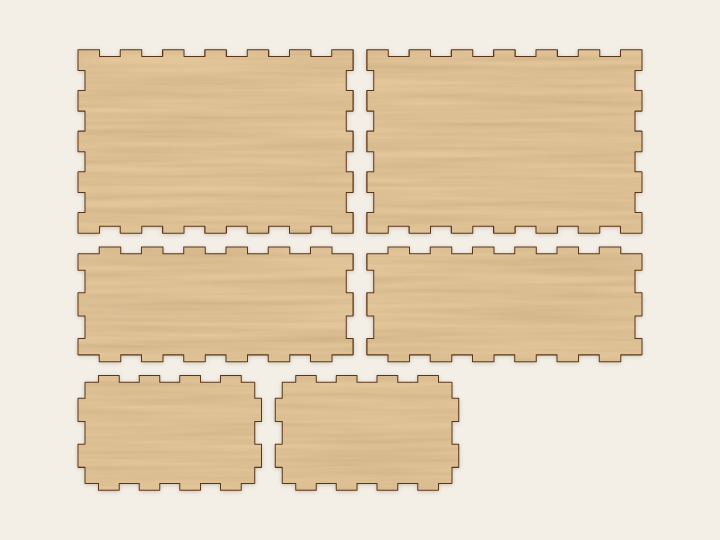
</td>
</tr>
</table>

```sh
npx @mylasertools/kerfscript render box.kerf -o box.svg -D width=200
```

That writes all six panels packed on a sheet, kerf compensated, as a
millimetre SVG with one layer per operation. Output is checked automatically
in Inkscape; see [docs/compatibility.md](docs/compatibility.md) for what has
and has not been tested in other laser software.

## Made with KerfScript

Every model is a file in [examples/](examples). Open one on the website to
turn it around in 3D, change its settings and download the SVG or DXF, or copy
it as the start of your own design.

<table>
<tr>
<td width="33%" valign="top"><a href="https://kerfscript.mylasertools.com/models/hadal/">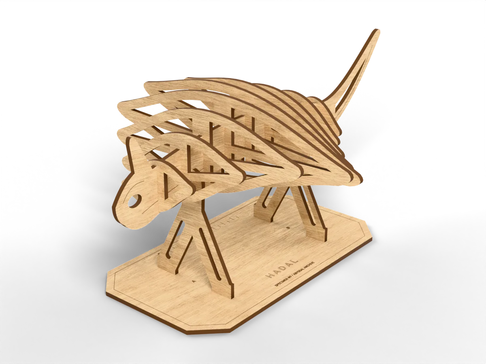</a><br><b><a href="https://kerfscript.mylasertools.com/models/hadal/">Hadal sculpture</a></b><br><sub>13 slotted parts, ribs computed from lists</sub></td>
<td width="33%" valign="top"><a href="https://kerfscript.mylasertools.com/models/tilt-maze/">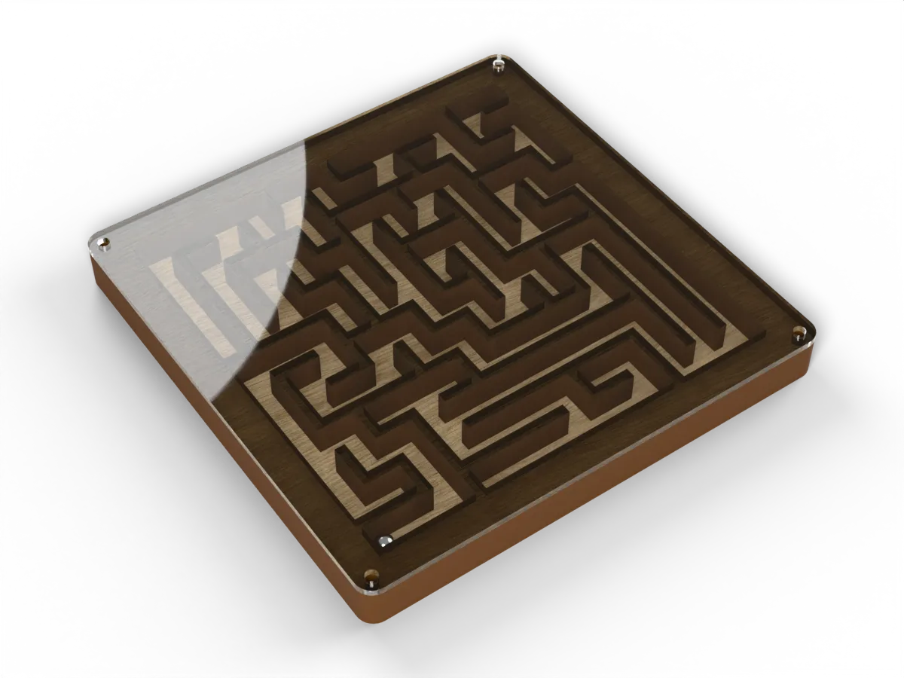</a><br><b><a href="https://kerfscript.mylasertools.com/models/tilt-maze/">Tilt maze</a></b><br><sub>a new maze for every seed, by recursion</sub></td>
<td width="33%" valign="top"><a href="https://kerfscript.mylasertools.com/models/topo-island/">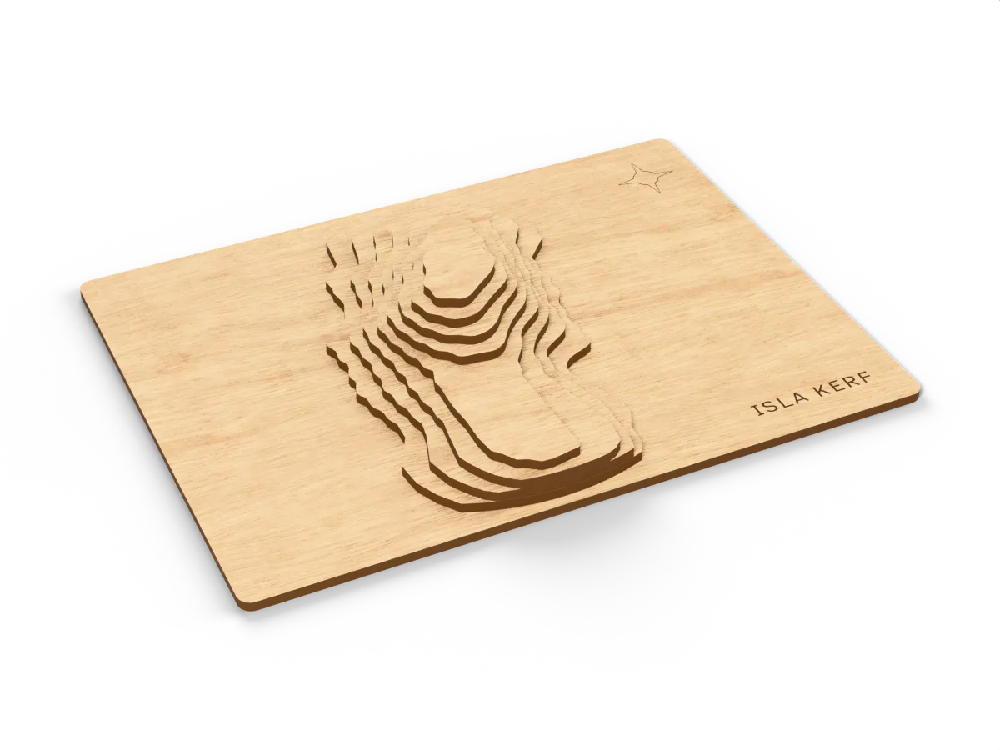</a><br><b><a href="https://kerfscript.mylasertools.com/models/topo-island/">Layered island</a></b><br><sub>contours traced from a height formula</sub></td>
</tr>
<tr>
<td width="33%" valign="top"><a href="https://kerfscript.mylasertools.com/models/fractal-tree/">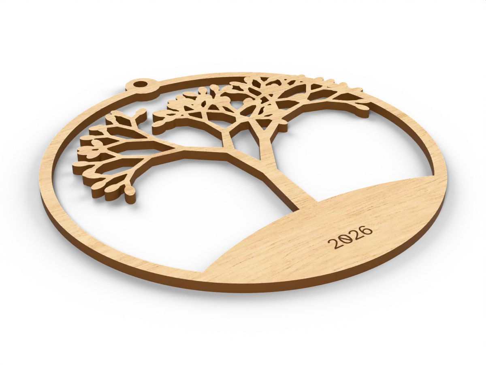</a><br><b><a href="https://kerfscript.mylasertools.com/models/fractal-tree/">Fractal tree</a></b><br><sub>a module that calls itself</sub></td>
<td width="33%" valign="top"><a href="https://kerfscript.mylasertools.com/models/round-badge/">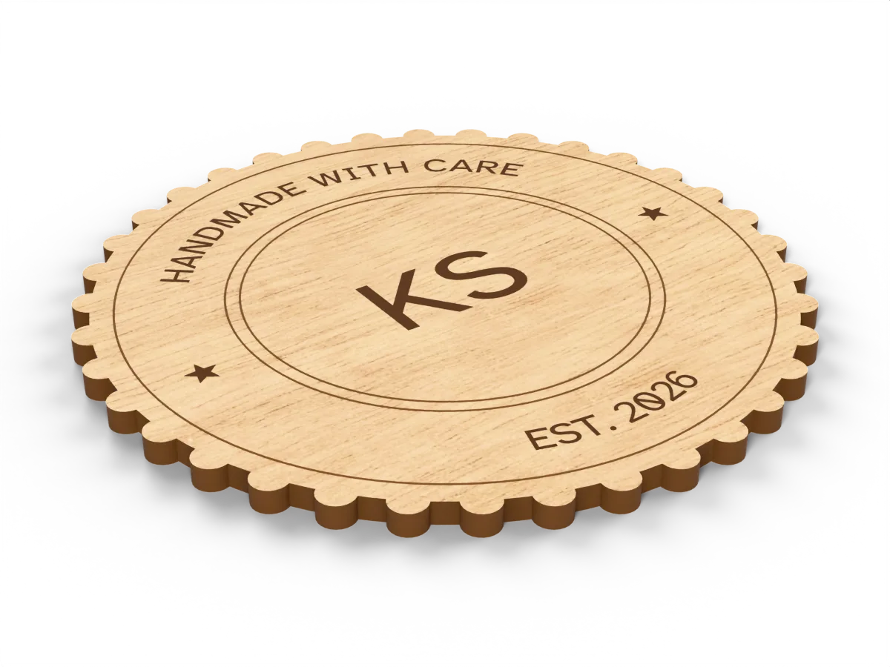</a><br><b><a href="https://kerfscript.mylasertools.com/models/round-badge/">Round badge</a></b><br><sub>text set letter by letter around a circle</sub></td>
<td width="33%" valign="top"><a href="https://kerfscript.mylasertools.com/models/winterlight/">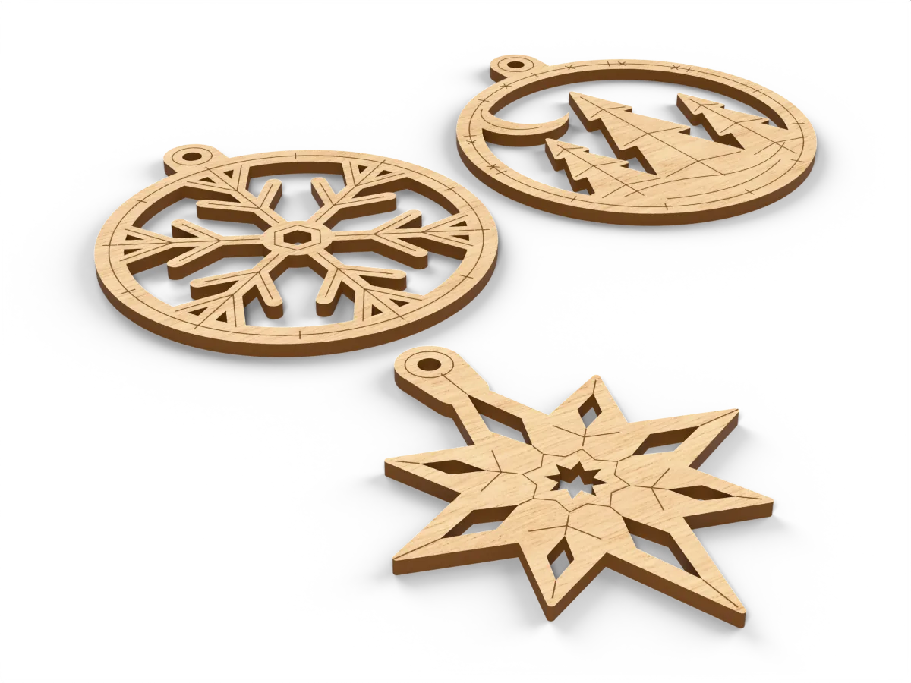</a><br><b><a href="https://kerfscript.mylasertools.com/models/winterlight/">Winterlight ornaments</a></b><br><sub>one-piece ornaments with scored detail</sub></td>
</tr>
<tr>
<td width="33%" valign="top"><a href="https://kerfscript.mylasertools.com/models/xenospora/">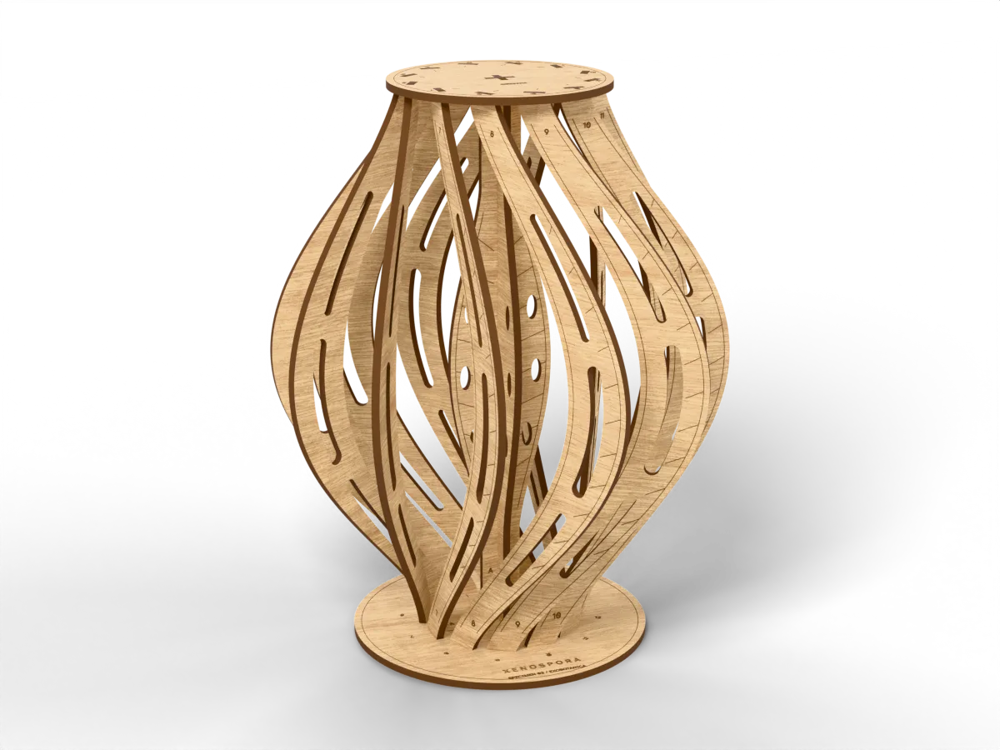</a><br><b><a href="https://kerfscript.mylasertools.com/models/xenospora/">Xenospora seed pod</a></b><br><sub>16 parts on 3 sheets, one file per sheet</sub></td>
<td width="33%" valign="top"><a href="https://kerfscript.mylasertools.com/models/solstice/">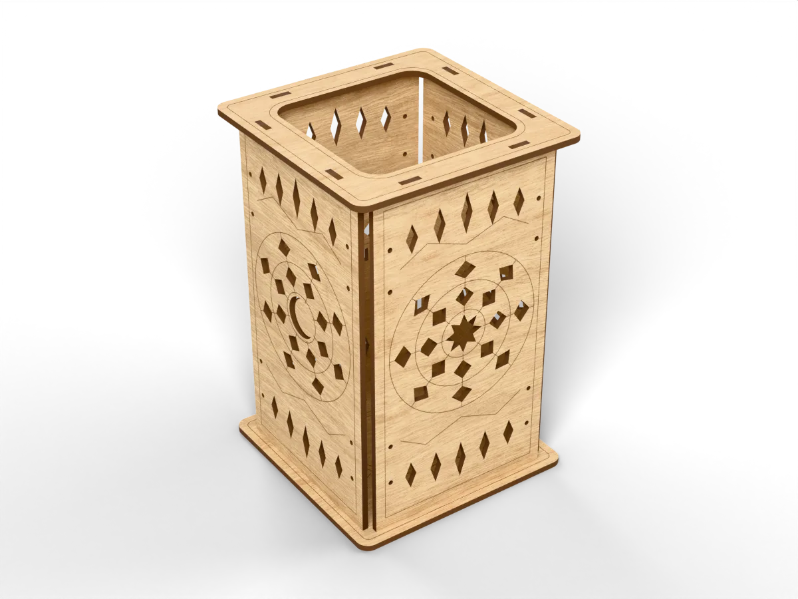</a><br><b><a href="https://kerfscript.mylasertools.com/models/solstice/">Solstice lantern</a></b><br><sub>tabs, slots and a fit test piece</sub></td>
<td width="33%" valign="top"><a href="https://kerfscript.mylasertools.com/models/box/">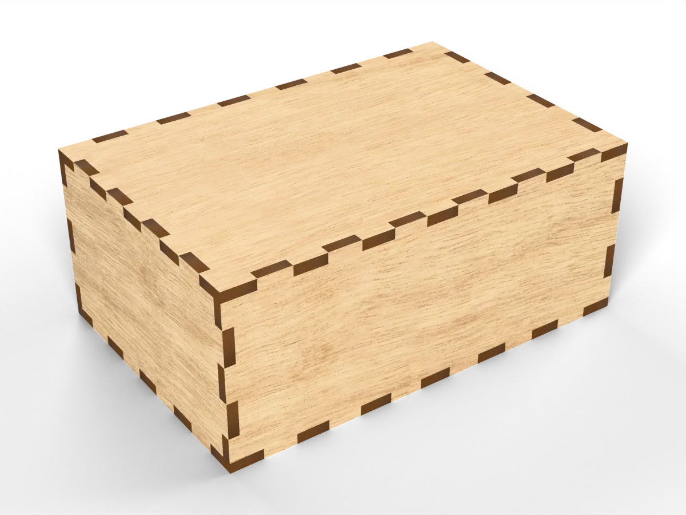</a><br><b><a href="https://kerfscript.mylasertools.com/models/box/">Finger-jointed box</a></b><br><sub>six panels from one library call</sub></td>
</tr>
<tr>
<td width="33%" valign="top"><a href="https://kerfscript.mylasertools.com/models/wave-cathedral/">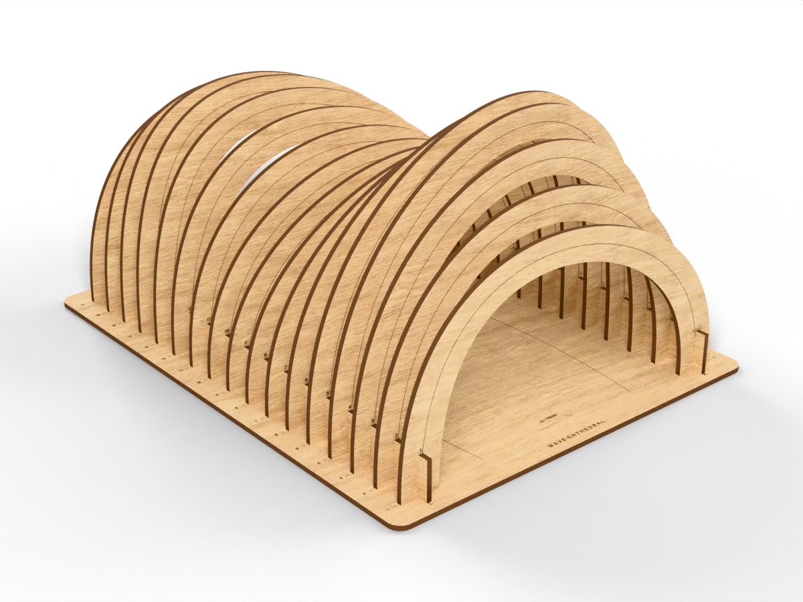</a><br><b><a href="https://kerfscript.mylasertools.com/models/wave-cathedral/">Wave Cathedral</a></b><br><sub>17 different ribs from one formula</sub></td>
<td width="33%" valign="top"><a href="https://kerfscript.mylasertools.com/models/gift-tags/">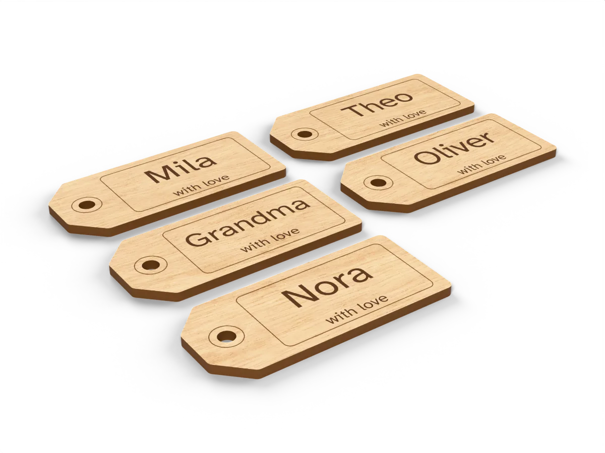</a><br><b><a href="https://kerfscript.mylasertools.com/models/gift-tags/">Gift tags from a list</a></b><br><sub>one tag per name, each name fitted</sub></td>
<td width="33%" valign="top"><a href="https://kerfscript.mylasertools.com/models/umbra/">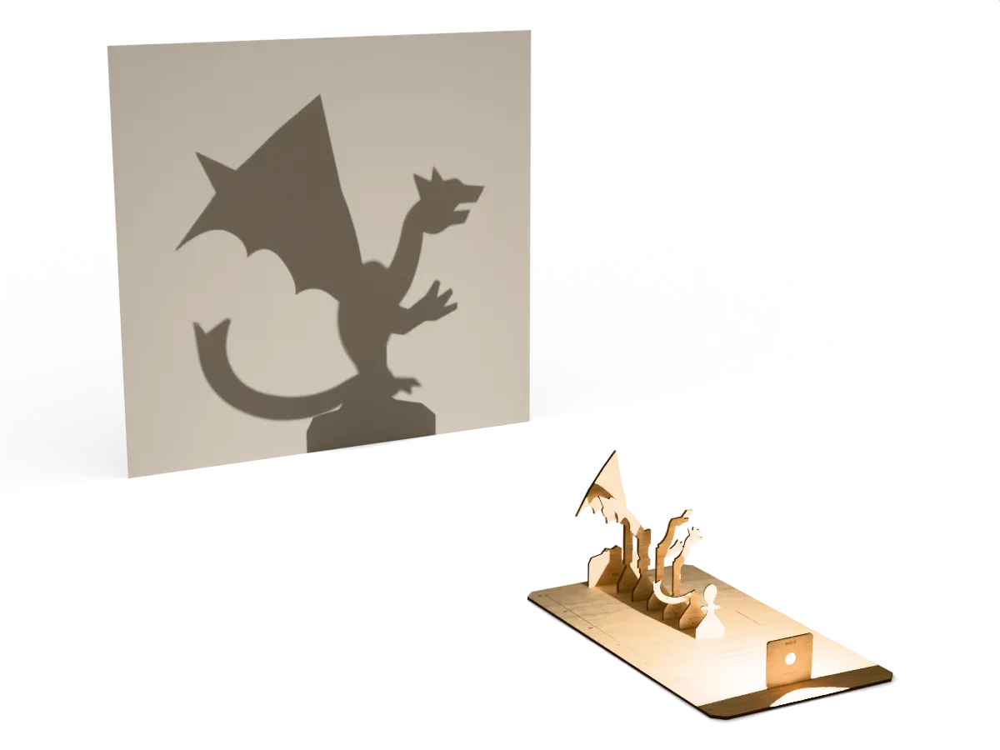</a><br><b><a href="https://kerfscript.mylasertools.com/models/umbra/">Umbra shadow machine</a></b><br><sub>six fins whose shadows make one dragon</sub></td>
</tr>
</table>

## Why a new language

- **Laser concepts are built in.** `engrave()`, `score()` and `cut()` put
  geometry on machine layers. Engraving is clipped to the material, inner
  cuts come before outer ones, and the whole part is offset by half the kerf.
- **Parts, not just shapes.** `part("lid", qty = 2)` names a piece; the
  renderer packs parts by material and thickness onto sheets.
- **Joinery that follows the material.** `finger_rect`, `finger_holes`,
  `tslot` and `living_hinge` use `$thickness`, so the joints resize when the
  material changes. Measure your kerf and cut a test piece for a snug fit.
- **Readable code.** Variables, modules, functions, loops and transforms like
  `translate()` and `rotate()`. Settings come from comments such as
  `// [10:1:100]`, which the playground turns into sliders. If you have used
  OpenSCAD, [Coming from OpenSCAD](docs/openscad.md) lists what differs.
- **Runs anywhere.** Pure TypeScript with no native code: the same interpreter
  runs in browsers, Node, workers and the command line.
- **Contained.** Programs read libraries only through the resolver you
  provide and have no other access to files or the network. Step, recursion
  and size limits stop runaway programs, and errors name the line. Run
  programs you did not write in a worker or process you can stop; see
  [Running untrusted code](docs/javascript.md#running-untrusted-code).

## Install

```sh
npm install @mylasertools/kerfscript
```

## Command line

```sh
kerf render design.kerf -o design.svg      # or .dxf / .json
kerf render design.kerf -D width=200 -D 'label="Oak"' --font Inter.ttf
kerf render design.kerf --sheet 400x300 --kerf 0.1 --split
kerf params design.kerf                    # customizer parameters as JSON
kerf check design.kerf                     # parts, sizes, cut length, warnings
```

## Library

```js
import { render, parameters } from '@mylasertools/kerfscript';

const result = render(source, {
  params: { width: 200 },
  fonts: { inter: await (await fetch('/Inter.ttf')).arrayBuffer() },
  sheet: [600, 400],
});

result.svg; // all sheets in one SVG
result.sheets; // [{ width, height, material, thickness, svg, dxf, items }]
result.parts; // [{ name, qty, width, height, pieces, cutLength, thickness, kerf, material }]
result.warnings; // e.g. a part that falls apart, or one bigger than the sheet
result.echoes; // echo() output

parameters(source).parameters; // [{ name, caption, group, type, initial, min, max, step, options, span }]
```

Errors are thrown as `KerfError` with `line` and `col`.

## Learn the language

- [Getting started](docs/getting-started.md), then the guides on
  [layers](docs/layers.md), [kerf](docs/kerf.md),
  [parts and sheets](docs/parts-and-sheets.md), [settings](docs/customizer.md),
  the [desktop app](docs/desktop.md), the [command line](docs/cli.md), the
  [JavaScript API](docs/javascript.md)
  and [WebAssembly](docs/webassembly.md) for other languages
- [Coming from OpenSCAD](docs/openscad.md): what is the same and what is not
- [LANGUAGE.md](LANGUAGE.md): the full language reference
- [Versions](docs/versions.md): language and package versions, and what stays
  stable before 1.0
- [examples/](examples): every model on the website, including a
  calibration square and a kerf test

## Community

Bug reports, cut reports and ideas are welcome; see
[CONTRIBUTING.md](CONTRIBUTING.md), the [roadmap](ROADMAP.md),
[SECURITY.md](SECURITY.md) and the [code of conduct](CODE_OF_CONDUCT.md).

## Licence

Copyright (c) 2026 MyLaserTools.

KerfScript is free software under the
[GNU AGPL 3.0](LICENSE), with an [additional permission](COMMERCIAL-LICENSE.md#additional-permission-your-designs-are-yours)
that makes **your `.kerf` designs and the files KerfScript generates yours to
license and sell however you like**.

Building KerfScript into a closed-source app, machine or service? The
[commercial licence](COMMERCIAL-LICENSE.md#free-commercial-licence) is free:
just email hi@mylasertools.com.

"KerfScript" is a trademark of MyLaserTools; see [TRADEMARKS.md](TRADEMARKS.md).
Contributions need the [CLA](CLA.md); see [CONTRIBUTING.md](CONTRIBUTING.md).
Bundled third-party code is listed in [THIRD-PARTY-NOTICES.md](THIRD-PARTY-NOTICES.md).
